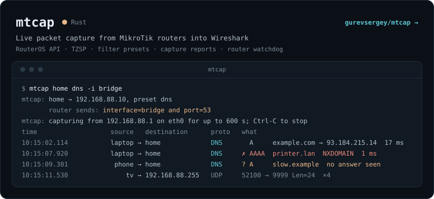

<picture>
  <source media="(prefers-color-scheme: dark)" srcset="assets/dashboard-dark.svg">
  <source media="(prefers-color-scheme: light)" srcset="assets/dashboard-light.svg">
  
</picture>

Networks first: routing, tunnels and firewalls on Linux and MikroTik, watched with Prometheus and Grafana, rolled out with Ansible. When a tool is missing, I write it in Rust.

### Tech Stack

### Featured

<a href="https://github.com/gurevsergey/mtcap">
  <picture>
    <source media="(prefers-color-scheme: dark)" srcset="assets/mtcap-dark.svg">
    <source media="(prefers-color-scheme: light)" srcset="assets/mtcap-light.svg">
    
  </picture>
</a>

### Projects

| Project | What it does | Built with |
|---|---|---|
| **[mtcap](https://github.com/gurevsergey/mtcap)** | Live packet capture from MikroTik routers into Wireshark: starts the sniffer over the API, unwraps TZSP, ships filter presets and capture reports | Rust, RouterOS API, tshark |
| **[next-hop](https://github.com/gurevsergey/next-hop)** | `hop`, a command-line location switcher with per-app routing, failover and a kill switch | Rust, nftables, systemd |
| **[dotfiles](https://github.com/gurevsergey/dotfiles)** | My Arch Linux desktop on Hyprland with Waybar, kitty, fish, rofi, Neovim and tmux, plus guides to the tmux and Neovim setup | Lua, shell, Python |

### How I work

- **Measure before changing.** A capture or a graph first, a config change second.
- **Leave the router as I found it.** My tools restore settings on exit and carry a watchdog for when the laptop disappears.
- **Write it down.** Every change ends in a note: what was asked, what was done, how it was checked.

### Lab

At home: a routing lab in EVE-NG for BGP practice, and a Prometheus and Grafana stack watching the network.
