<picture>
  <source media="(prefers-color-scheme: dark)" srcset="assets/header-dark.svg">
  <source media="(prefers-color-scheme: light)" srcset="assets/header-light.svg">
  
</picture>

Networks first: routing, tunnels and firewalls on Linux and MikroTik, watched with Prometheus and Grafana, rolled out with Ansible. When a tool is missing, I write it in Rust.

### Featured

<a href="https://github.com/gurevsergey/mtcap">
  <picture>
    <source media="(prefers-color-scheme: dark)" srcset="assets/mtcap-dark.svg">
    <source media="(prefers-color-scheme: light)" srcset="assets/mtcap-light.svg">
    
  </picture>
</a>

**[mtcap](https://github.com/gurevsergey/mtcap)**: live packet capture from MikroTik routers into Wireshark, with filter presets and capture reports.

**[next-hop](https://github.com/gurevsergey/next-hop)**: `hop`, a command-line location switcher with per-app routing, failover and a kill switch.

**[dotfiles](https://github.com/gurevsergey/dotfiles)**: my Arch Linux desktop on Hyprland, with Waybar, kitty, fish, rofi and Zed in one palette.
